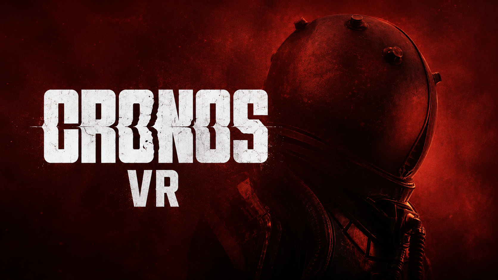
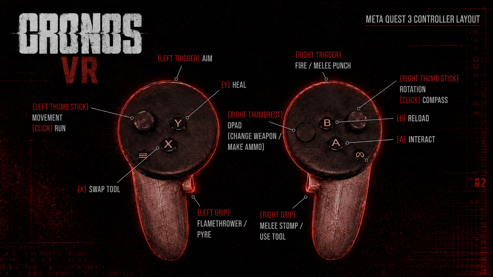

# Cronos: The New Dawn – UEVR VR Profile

A full motion-controller VR conversion of Cronos: The New Dawn for UEVR, with visible hands, guns that shoot where you point them, two-handed aiming, roomscale turning, a hand-held flashlight, punch melee and trap mines aimed with your hand. Special thanks to praydog, jbusfield (for his libs framework), DJ and Keyser-Soze!

## IMPORTANT!

- My custom UEVR backend is required - see the releases on [letmein-vr/UEVR](https://github.com/letmein-vr/UEVR/releases) to download it.
- Download the profile from the [releases](https://github.com/letmein-vr/CRONOS_UEVR/releases) (latest: [1.3](https://github.com/letmein-vr/CRONOS_UEVR/releases/tag/1.3)).

## Features

### Hands and body

- **VR hands.** The Traveler's hands and arms are rendered on both motion controllers, with grip poses for each weapon.
- **Roomscale turning.** Turn your body or head in real life and the Traveler turns with you, 1:1. The game always knows where you are facing, so interaction prompts appear for what you look at. The right stick still turns as usual.

### Weapons and combat

- **Weapon in hand.** The current weapon sits in your right hand and stays solid all the time, also up close, while reloading and after melee. Bullets come out of the barrel of every gun and never hit you, thanks to a small native plugin (CronosAimFix.dll, source in `source/CronosAimFix`).
- **Two-handed aiming.** Bring your left hand to the gun's barrel or handle and hold the left grip; the gun then pivots between both hands, with a left-hand pose per weapon. Can be turned off in the Cronos VR panel.
- **Reloading** works as in the game, with the gun staying in your hand.
- **Punch melee.** Punch forward with the right controller to trigger the punch attack.
- **Trap mines from the hand.** Hold the left grip to bring up a trap mine, point the right controller where you want it and release; the arc and the throw follow the controller.
- **3D reticle.** The game's weapon reticle is placed in the world at the point the gun aims at (can be turned off).

### Flashlight

- **Hand flashlight.** The flashlight light follows your left hand.
- **Flashlight toggle.** Put your right hand to the back of the flashlight on your left arm and press the right grip to switch it on or off.

### Cutscenes and traversal

- **Cinematic handling.** Cutscenes, vents, squeezing through gaps and wall walking hand the camera to the game and give it back afterwards. On entry the view is recentred to where you are facing, and on exit it picks up from where you look, so there is no snap even after a lot of physical turning.

### Camera and comfort

- **First-person 6DOF** with the eye placed on the Traveler's head.
- **Head-locked UI.** The HUD follows your view.
- **Spatial audio from the headset.** Sound is heard from your head position.

## Controls

| Action | Input |
|---|---|
| Move | Left stick |
| Turn | Right stick, or turn in real life |
| Fire | Right trigger |
| Two-hand a gun | Left hand to the barrel or handle, hold left grip |
| Punch | Punch forward with the right controller |
| Trap mine | Hold left grip, aim with the right controller, release to throw |
| Flashlight on / off | Right hand to the back of the left-arm flashlight, right grip |
| HUD interaction prompts | Right stick up / down |

The D-pad is mapped to the left controller (HMD + left stick); you can change this in UEVR's input settings.

## Installation

1. Install my custom UEVR (see above).
2. Import the release profile in UEVR (or copy the files into `%APPDATA%\UnrealVRMod\Cronos-Win64-Shipping`).
3. Start the game and inject UEVR.

## Tuning

Everything is adjustable in the UEVR overlay, without editing files:

- **Cronos VR** – two-handing and 3D reticle on/off. Under **Dev Tools**: per-weapon right- and left-hand offsets, the left-hand socket, grip and hand box sizes, spotlight offsets and the flashlight toggle zone. Values are saved per weapon.
- **Cronos Roomscale** – roomscale turning, body follows head 1:1, and head pitch driving the game's view.
- **Cronos Weapon** – gun on controller (keeps the gun and right hand solid).
- **Attachments Config Dev** – weapon and flashlight attachment offsets.

## Under the hood

Built on jbusfield's shared uevrlib Lua framework, running on my UEVR backend. Game-specific logic lives in a few scripts on top of the framework:

- `hands.lua` – hands, weapon and flashlight attachment, cutscene handling, the punch gesture and the 3D reticle. The gun hangs off a component the Traveler owns that rides on the right controller, so the game still treats it as the player's gun (reloads, not hitting yourself) while it renders like part of the controller (no close-camera dither). The muzzle point is moved onto each gun's own barrel socket.
- `two_handed_integration.lua` – two-handed aiming, per-weapon profiles and the flashlight toggle.
- `roomscale_turn.lua` – Cronos looks through its own view component rather than the controller rotation, so this script feeds your head direction into it, turns the body with you, keeps the image from turning twice, recentres on cutscene entry and aims trap mines with the right controller.
- `hmd_audio.lua` – audio listener on the headset.

The native plugin (CronosAimFix.dll) hooks the game's weapon trace calls: shots start at the barrel and follow it, and the player is added to the trace's ignore list. Its source is in `source/CronosAimFix`.

## Credits

- **praydog** – for creating [UEVR](https://github.com/praydog/UEVR) and making these mods possible.
- **jbusfield** – for the [uevrlib](https://github.com/jbusfield/uevrlib) helper libs framework.
- **DJ** – for creating the weapon trace for this game, and the visible crosshair code.
- **Keyser-Soze** – for finding some of the original meshes to hook, and for all the testing help.
