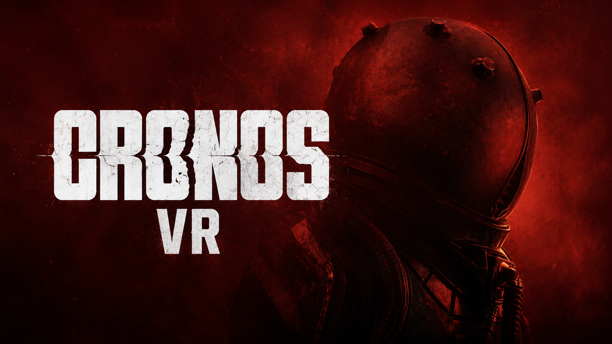
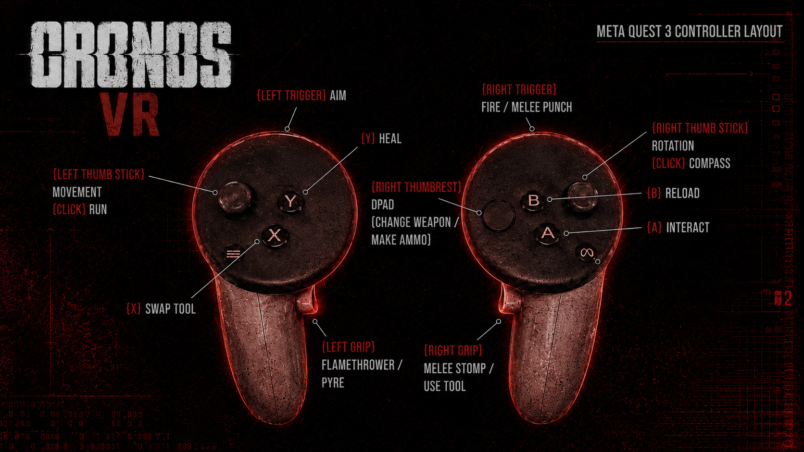

# Cronos: The New Dawn – UEVR VR Profile

A full motion-controller VR conversion of Cronos: The New Dawn for UEVR, with visible hands or full IK arms, guns that shoot where you point them, two-handed aiming, body holsters, roomscale turning, a head-mounted or hand-held flashlight, punch melee, trap mines aimed with your hand and an in-game VR tutorial. Special thanks to praydog, jbusfield (for his libs framework, HUD inspiration), Lukasblaster (HUD inspiration) DJ and Keyser-Soze!

## IMPORTANT!

- **Easiest:** download `CronosVR_Launcher.exe` from the [latest release](https://github.com/letmein-vr/CRONOS_UEVR/releases/latest). It installs the profile and a matching UEVR build, starts the game and injects VR for you (see [Installation](#installation)).
- Manual install: the latest [UEVR nightly](https://github.com/praydog/UEVR-nightly/releases) is required, plus the profile from the [latest release](https://github.com/letmein-vr/CRONOS_UEVR/releases/latest).
- **Known issue:** the Cronos game patch of 26 October 2026 breaks the in-game interaction prompts in VR (this happens with UEVR alone, with no profile loaded). Use the previous game version until UEVR or the game is updated.

## Features

### Hands and arms

- **Two hand modes.** Switch in the Cronos VR panel between **Hands** (the Traveler's hands and forearms on the motion controllers) and **IK Arms** (full arms that reach from the shoulders to your controllers). Both have grip poses for each weapon.
- **IK Arms extras.** The gun stays locked in the IK hand with no lag when you move or turn, the right hand's position on each gun can be adjusted per weapon, and the flashlight sits on the IK forearm.
- **Roomscale turning.** Turn your body or head in real life and the Traveler turns with you, 1:1, in both hand modes. The game always knows where you are facing, so interaction prompts appear for what you look at. The right stick still turns as usual.

### Weapons and combat

- **Weapon in hand.** The current weapon sits in your right hand and stays solid all the time, also up close, while reloading and after melee. Bullets come out of the barrel of every gun and never hit you, thanks to a small native plugin (CronosAimFix.dll, source in `source/CronosAimFix`).
- **Two-handed aiming.** Bring your left hand to the gun's fore-grip and hold the grab button (left grip by default, or left trigger); the gun then pivots between both hands. Works in both hand modes.
  - The left hand glides smoothly onto the gun and back to your controller (adjustable, or snap).
  - Each weapon has its own grip point, grab and release distance, and left-hand placement.
  - The left-hand grip pose can be captured per weapon from the game's own animation.
  - Optional debug spheres show the grip point and the flashlight toggle zone while tuning.
- **Weapon reticule.** The game's reticle for the current weapon mode is shown in the world along the barrel, exactly where shots go (also while two-handing). It is white, keeps the same apparent size at any distance, and its brightness, size and maximum distance are adjustable.
- **Weapon recoil.** Every shot kicks the gun in your hand (on/off in the panel).
- **Holsters.** Reach to a spot on your body and press the right grip to switch weapons: right hip = slot 1, right shoulder = slot 2, left shoulder = slot 3, left hip = slot 4. A short buzz tells you your hand is on a holster. The d-pad still selects slots too.
- **Reloading** works as in the game, with the gun staying in your hand.
- **Punch melee.** Punch forward with the right controller to trigger the punch attack. The punch speed needed is adjustable.
- **Trap mines from the hand.** Hold the left grip to bring up a trap mine, point the right controller where you want it and release; the arc and the throw follow the controller.

### Flashlight

- **Head-mounted (default).** The light sits on your head and shines where you look. Bring your left controller to your head and press the left grip to switch it on or off.
- **On the left arm.** The flashlight follows your left hand (offset tunable per weapon). Put your right hand to it and press the right grip to switch it on or off.

### Cutscenes and traversal

- **Cinematic handling.** Cutscenes, vents, squeezing through gaps, ladders and wall walking hand the camera to the game and give it back afterwards. On entry the view is recentred to where you are facing, and on exit it picks up from where you look, so there is no snap even after a lot of physical turning.

### Camera and comfort

- **First-person 6DOF** with the eye placed on the Traveler's head.
- **Head-locked UI.** The HUD follows your view.
- **Immersive HUD (optional).** Health on your left hand, ammo on the gun, the rest of the HUD in view. Off by default; switch it on in the panel.
- **Spatial audio from the headset.** Sound is heard from your head position.

### VR tutorial

- **In-game tutorial.** Picture pages that explain the VR controls, shown once when you first reach gameplay. Bring your left controller up to your eyes and pull the left trigger to open it again at any time; the game pauses while it is open. A = next, X = back, B = close, Y = don't show at startup.

## Controls

| Action | Input |
|---|---|
| Move | Left stick |
| Turn | Right stick, or turn in real life |
| Fire | Right trigger |
| Two-hand a gun | Left hand to the gun's fore-grip, hold left grip (or left trigger, see the panel) |
| Punch | Punch forward with the right controller |
| Trap mine | Hold left grip, aim with the right controller, release to throw |
| Switch weapon (holsters) | Right grip at the right hip (1), right shoulder (2), left shoulder (3) or left hip (4) |
| Flashlight on / off | Head-mounted: left controller to your head, left grip. On the arm: right hand to the left-arm flashlight, right grip |
| VR tutorial | Left controller to your eyes, pull the left trigger |
| HUD interaction prompts | Right stick up / down |

The D-pad is mapped to the left controller (HMD + left stick); you can change this in UEVR's input settings.

## Installation

### With the Cronos VR Launcher (recommended)

1. Download `CronosVR_Launcher.exe` from the [latest release](https://github.com/letmein-vr/CRONOS_UEVR/releases/latest) and run it. Nothing else is needed: it carries the profile and a tested UEVR build.
2. Pick your options. The **VR** tab has the headset runtime (OpenXR / OpenVR), resolution scale and turning; the **Gameplay** tab has the main Cronos VR panel options (hand mode, two-handed aiming, recoil, HUD, holsters, flashlight, reticule, tutorial).
3. Press **LAUNCH**. The launcher installs or updates the profile, saves your options, starts the game through Steam and injects UEVR once the game window is up (after a short countdown; **Inject now** skips it).

Good to know:
- An existing profile is backed up to `%APPDATA%\UnrealVRMod\Backups` before an update, and your panel settings and tutorial progress are carried over.
- The launcher checks GitHub for newer profile releases and offers them with one click.
- If the game is already running without VR, the button becomes **INJECT VR**.
- Advanced tab: inject delay, closing the launcher after injecting, automatic profile updates, starting the game exe directly instead of Steam.
- Everything can still be changed in game from the UEVR menu (Cronos VR panel).

### Manual

1. Install the latest UEVR nightly (see above).
2. Import the release profile in UEVR (or copy the files into `%APPDATA%\UnrealVRMod\Cronos-Win64-Shipping`, including the `plugins` folder).
3. Start the game and inject UEVR.

## Tuning

Everything is adjustable in the UEVR overlay, without editing files. All settings are in one **Cronos VR** panel:

- **Hands** – Hands or IK Arms.
- **Two-Handed Aiming** – on/off, left-hand glide time, grab button, hiding the grab button from the game, snapping the left hand to the grip.
- **Weapon Recoil** – on/off.
- **Immersive HUD** – on/off.
- **Holsters** – on/off (zone positions and size under Dev Config).
- **Roomscale** – roomscale turning, body follows head 1:1, and head pitch driving the game's view.
- **Flashlight Spotlight** – head-mounted or on the left arm, spotlight position and rotation, saved per weapon.
- **VR Tutorial** – show it now, the eye gesture on/off, pausing on/off, and showing it again at the next start.
- **Weapon Reticule** – on/off, brightness, max distance, constant apparent size, size.
- **Melee** – the punch speed needed to trigger a punch.
- **Dev Config** – per-weapon grip points and grab radii, right- and left-hand offsets for both hand modes, left-hand pose capture, debug spheres, the IK flashlight position, the flashlight toggle zone and gun on controller. Weapon values are saved per weapon.

Weapon and flashlight attachment offsets are in the separate **Attachments Config** panel.

## Under the hood

Built on jbusfield's shared uevrlib Lua framework (with its `uevr_utils.dll` and `tarray_helper.dll` plugins). Game-specific logic lives in a few scripts on top of the framework:

- `hands.lua` – Hands / IK Arms modes, weapon and flashlight attachment, cutscene handling, the punch gesture and the weapon reticule. The gun hangs off a component the Traveler owns, so the game still treats it as the player's gun (reloads, not hitting yourself) while it renders like part of your hand (no close-camera dither). In Hands mode that component rides the right controller; in IK Arms mode it rides the IK arm. The muzzle point is moved onto each gun's own barrel socket, and the reticule is traced from it along the barrel.
- `two_handed_integration.lua` – two-handed aiming, per-weapon profiles, the flashlight toggle and the IK weapon lock. The lock places the gun where the IK hand holds it, at the moment the arm is solved, so gun and arms never drift apart.
- `roomscale_turn.lua` – Cronos looks through its own view component rather than the controller rotation, so this script feeds your head direction into it, turns the body with you, keeps the image from turning twice, recentres on cutscene entry and aims trap mines with the right controller.
- `holsters.lua` – the body holster zones (boxes around the head, facing where you look) that turn a right grip press into the matching d-pad weapon slot.
- `vr_tutorial.lua` – the VR tutorial (jbusfield's tutorial lib from his Atomic Heart profile), pages in `data/tutorial/`.
- `hmd_audio.lua` – audio listener on the headset.
- `zz_cronos_vr_panel.lua` – builds the single Cronos VR panel from the other scripts' settings.

The native plugin (CronosAimFix.dll) hooks the game's weapon trace calls: shots start at the barrel and follow it, and the player is added to the trace's ignore list. Its source is in `source/CronosAimFix`.

## Credits

- **praydog** – for creating [UEVR](https://github.com/praydog/UEVR) and making these mods possible.
- **jbusfield** – for the [uevrlib](https://github.com/jbusfield/uevrlib) helper libs framework.
- **DJ** – for creating the weapon trace for this game, and the visible crosshair code.
- **Keyser-Soze** – for finding some of the original meshes to hook, and for all the testing help.
